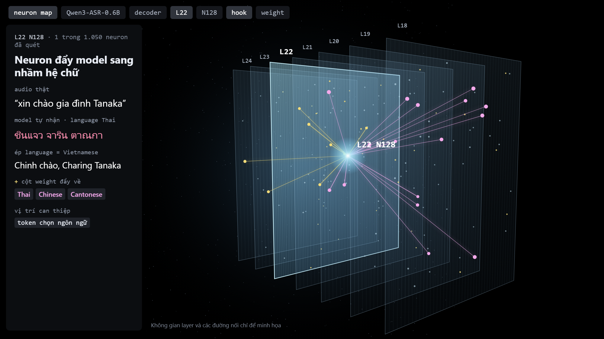
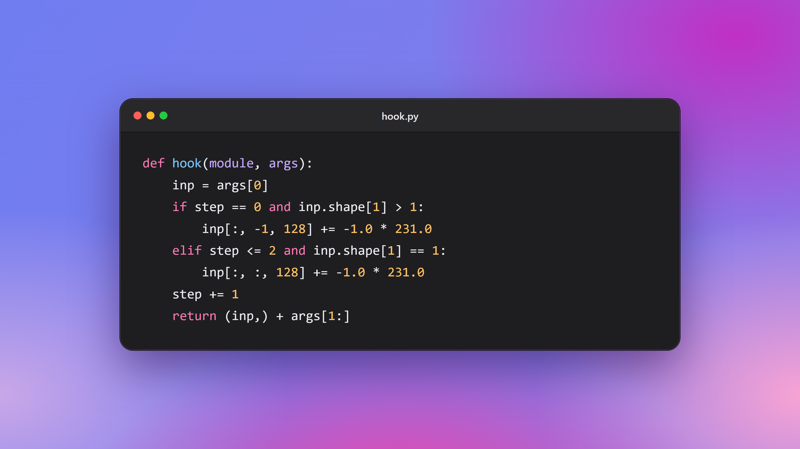

Dạo này mình hay vọc Qwen3-ASR-0.6B, một model nhận dạng giọng nói mã nguồn mở của team Qwen. Model khoảng 0,8 tỉ tham số, hỗ trợ 30 ngôn ngữ, trong đó có tiếng Việt. Nó nhỏ, chạy được trên máy cá nhân, nên mình rất thích.

Cho tới khi mình thấy câu này. Audio là "xin chào gia đình Tanaka":

<audio controls src="/docs/audio/xin-chao-gia-dinh-tanaka.flac"></audio>

còn model trả về:

`ชินแจว จาริน ตาณกา`

Lúc đầu mình tưởng lỗi rác. Nhưng đọc thử theo âm Thái thì nó ra gần như "chin-chao cha-rin ta-na-ka". Hóa ra model nghe được khá nhiều âm, nhưng lại chọn nhầm bảng chữ cái. Ép nó sang tiếng Việt thì ra "Chinh chào, Charing Tanaka": chưa đúng hết, nhưng đã gần câu gốc hơn hẳn 😅

## Bug hay gap?

Trước khi sửa, mình phải tự hỏi: đây là **bug** hay **gap**?

- **Gap** là model chưa học tới. Cái này phải thêm data, phải train.
- **Bug** là model biết rồi, nhưng có thứ gì đó chặn lại. Cái này mới có cửa sửa thẳng vào bên trong.

Phần lớn lỗi tiếng Việt của model, mình đo ra, là gap. Nhưng lỗi chữ Thái thì khác: ở 12/18 vị trí mình kiểm tra, từ đúng đã lọt top-10 ở các layer giữa. Tức là trong đầu nó đã có đáp án.

## Truy tìm nghi phạm

Qwen3-ASR có một thói quen: nó sinh thẻ ngôn ngữ trước, rồi mới chép lời. Thẻ mà sai thì cả câu đi theo luôn. Thế là mình để một LLM vào "soi" model cùng với logit lens, attribution và cách quét neuron kiểu neuron-explorer. Sau khi quét 1.050 neuron ở layer 18 đến 24, nghi phạm lộ ra: **neuron 128 ở layer 22**. Cột weight của nó đẩy model về phía tiếng Thái, tiếng Trung và tiếng Quảng Đông.

Mình thử dùng hook ức chế neuron này, chỉ đúng ở các token quyết định ngôn ngữ:

- Sửa được 8/8 câu lỗi
- Không làm hỏng câu nào trong 8 câu sạch
- Thử hướng ngẫu nhiên cùng layer để đối chứng thì chỉ sửa được trung bình 1,6/8, lại còn làm hỏng 2,2/8

Chỉ một can thiệp nhỏ như vậy mà WER trên tập thử giảm khoảng 0,6 điểm, tương đương gần 4% số lỗi. Lúc đó mình mừng lắm, tưởng xong rồi.

## Chưa đâu 🥲

Đem ghi thẳng vào weight thì hỏng. Xóa cột của neuron: sửa được 0/8. Thử cách bias: sửa được lỗi, nhưng phá 20/207 câu đang đúng, WER còn tăng lên. Mình hiểu ra là hook chọn được *lúc nào* can thiệp, còn weight thì tác động ở *mọi bước*, kể cả khi model đang chép lời bình thường.

:::caution[Nói cho công bằng]
Mình mới kiểm tra nhân quả trên 8 câu lỗi, kết quả hook chưa chạy trên tập test, và lỗi này chỉ chiếm khoảng 2% số câu ở tập mình đo. Nên mình chưa dám gọi neuron 128 là "công tắc ngôn ngữ" của model, chỉ có thể nói nó có vai trò thật trong lỗi này.
:::

---

### Nguồn tham khảo

- Audio mẫu: FPT Open Speech Dataset (CC-BY-4.0), file `xin-chao-gia-dinh-tanaka.flac`.
- Weight-space programming: https://rikiyat.github.io/blog/weight-space-programming/
- neuron-explorer: https://github.com/lyramakesmusic/neuron-explorer

***

**Nam Nam** | *Blogger*
