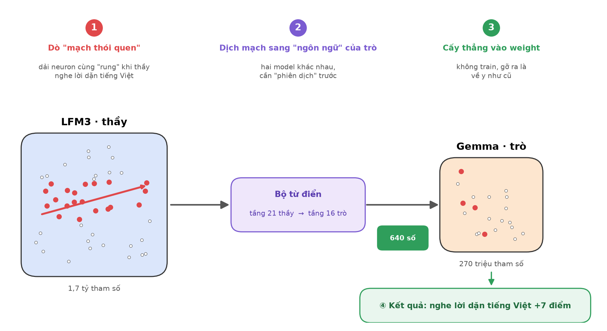
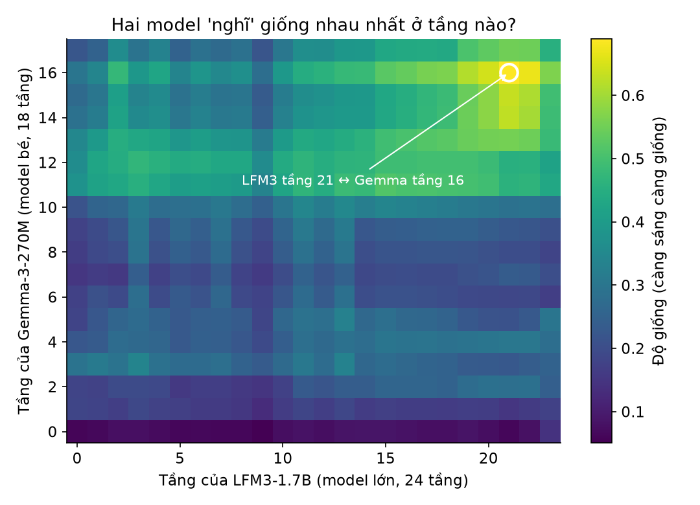
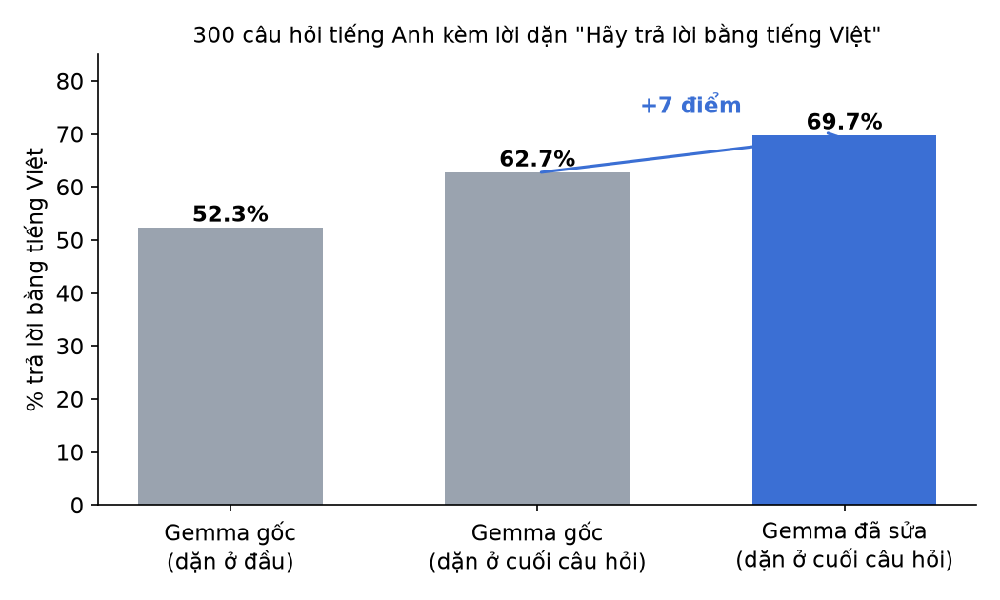
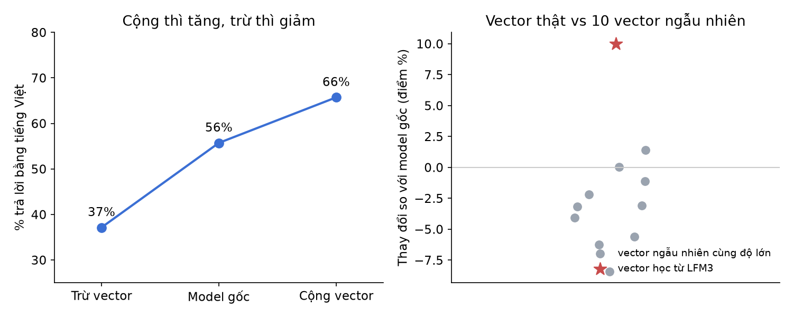
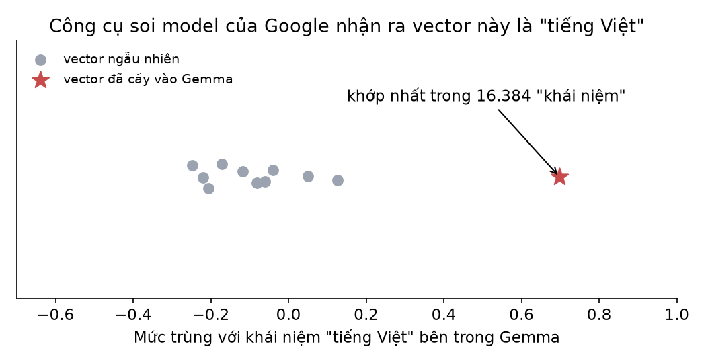

Anh em nào từng chạy model nhỏ cỡ vài trăm triệu tham số chắc gặp cảnh này rồi: dặn nó *"Hãy trả lời bằng tiếng Việt"*, nó vẫn tỉnh bơ trả lời một tràng tiếng Anh.

Cách thông thường để sửa là **fine-tune**: gom dữ liệu, thuê GPU, train vài tiếng, rồi cầu trời model không quên mất những gì nó đã biết. Tôi muốn thử một cách "lầy" hơn: **mở thẳng file weight ra, sửa bằng tay vài con số, không train gì cả.** Và lấy "khuôn mẫu" từ một model lớn hơn đã làm tốt việc đó.

## Hai nhân vật chính

- **Thầy:** `LiquidAI/LFM3-1.7B`, 1,7 tỷ tham số. Rất nghe lời khi được dặn trả lời tiếng Việt.
- **Trò:** `google/gemma-3-270m-it`, 270 triệu tham số, nhỏ hơn thầy khoảng 6 lần. Hay lờ lời dặn.

Mục tiêu: **làm trò cư xử giống thầy hơn, chỉ bằng cách sửa weight.**

## Ý tưởng: mỗi "thói quen" của model có một hướng riêng

Bên trong một LLM, mỗi từ khi đi qua các tầng sẽ được biểu diễn thành một dãy số rất dài, có thể hình dung như một điểm trong không gian nhiều chiều. Các nhà nghiên cứu phát hiện ra rằng nhiều "thói quen" của model, như nói ngôn ngữ nào, giọng vui hay buồn, có từ chối hay không, ứng với **một hướng** trong không gian đó. Hướng này được tạo bởi cả một dải neuron cùng "rung" theo một kiểu nhất định. Tôi gọi vui nó là **"mạch thói quen"**.

Đẩy biểu diễn theo hướng đó thì thói quen mạnh lên, đẩy theo chiều ngược lại thì yếu đi. Giống như một **núm vặn**. Một vài "mạch" mà giới nghiên cứu đã tìm ra:

| Mạch thói quen | Vặn lên thì model... | Vặn xuống thì model... |
|---|---|---|
| 😊 Cảm xúc | trả lời vui vẻ, nhiệt tình, dùng từ tích cực | trả lời buồn bã, u ám |
| 🌏 Ngôn ngữ | chuyển sang trả lời bằng ngôn ngữ đó | quay về ngôn ngữ mặc định |
| 🙅 Từ chối | dè dặt, từ chối những câu hỏi nguy hiểm | dễ dãi, cái gì cũng trả lời |
| 📏 Độ dài | trả lời dài dòng, giải thích kỹ | trả lời cụt lủn, đi thẳng vào ý |
| 🙇 Lễ phép | "Dạ, ạ", xưng hô kính cẩn | nói trống không, suồng sã |
| 🤥 Xu nịnh | đồng ý với người dùng kể cả khi họ sai | dám cãi khi người dùng sai |

Mạch tôi nhắm tới trong bài này là **"nghe lời dặn trả lời tiếng Việt"**.

Vậy kế hoạch là:

## Bước 1: Tìm tầng mà hai model "nghĩ giống nhau"

Hai model khác nhau hoàn toàn: khác hãng, khác kiến trúc, khác số tầng (24 vs 18), khác độ dài dãy số (2048 vs 640). Không thể bê nguyên mạch thói quen của thầy sang trò được.

Nên trước tiên tôi cho cả hai cùng đọc một đống văn bản tiếng Việt, rồi so xem **tầng nào của thầy giống tầng nào của trò nhất**:

Có một điểm sáng rất rõ: **tầng 21 của LFM3 ↔ tầng 16 của Gemma**. Cả hai đều nằm ở khoảng 85–90% chiều sâu của model. Hai model của hai hãng khác nhau mà lại "suy nghĩ" giống nhau nhất ở cùng một vị trí tương đối. Tôi thấy chi tiết này khá thú vị.

Từ đó tôi dựng một "bộ từ điển" (một phép biến đổi tuyến tính đơn giản) để dịch mạch thói quen từ thầy sang trò.

## Bước 2: Cái bẫy của Gemma 3

Cách "sách giáo khoa" là cấy mạch này vào đầu ra của khối MLP trong tầng đó. Nhưng làm vậy với Gemma 3 thì hỏng.

:::caution[Gemma 3 có thêm một lớp "chuẩn hóa" sau MLP]
Gemma 3 chuẩn hóa lại đầu ra của MLP trước khi cộng vào dòng chảy chính. Cấy mạch vào trước lớp này thì nó bị "nắn" lại, mỗi từ một kiểu, và lệch khỏi hướng ban đầu.

Cách sửa: cấy mạch vào **sau** lớp chuẩn hóa đó.
:::

Kết quả cuối cùng là chỉ **640 con số** được cộng thêm vào Gemma, trên tổng số 268 triệu, tức khoảng **0,0002%**. Muốn gỡ thì trừ đi là Gemma trở về y như cũ, không sai một bit.

## Bước 3: Kết quả

Tôi cho Gemma trả lời 300 câu hỏi tiếng Anh mà nó chưa từng thấy, mỗi câu kèm lời dặn *"Hãy trả lời bằng tiếng Việt"*:

- Gemma gốc, dặn ở đầu: khoảng **52%** chịu trả lời tiếng Việt.
- Gemma gốc, dặn ở cuối câu hỏi (cách dặn tốt nhất tôi tìm được): gần **63%**.
- **Gemma đã sửa**, cùng cách dặn: gần **70%**, tức nhỉnh hơn khoảng **7 điểm** so với cách dặn tốt nhất.

Đo lại trên các bộ câu hỏi khác nhau, mức tăng vẫn rơi vào khoảng 7 đến 10 điểm, nên có vẻ không phải ăn may.

### Giống thầy hơn ở điểm nào?

- **Nghe lời hơn:** đúng như mục tiêu.
- **Văn tiếng Việt "giống giọng thầy" hơn:** tôi cho chính LFM3 chấm các câu tiếng Việt do Gemma viết. Bản đã sửa được LFM3 đánh giá là "tự nhiên" hơn bản gốc. Đây là hiệu ứng phụ, tôi không nhắm tới nhưng lại có.
- **Không bị "nghiện" tiếng Việt:** hỏi tiếng Anh mà không dặn gì thì nó vẫn trả lời tiếng Anh như cũ. Thói quen chỉ bật lên khi cần.
- **Không mất gì đáng kể:** khả năng viết tiếng Anh gần như giữ nguyên, khả năng viết tiếng Việt còn nhỉnh lên một chút.

Một ví dụ:

> **Hỏi:** Describe the feeling of winning a big award. *Hãy trả lời bằng tiếng Việt.*
>
> **Gemma gốc:** *Winning a big award is a truly remarkable experience. It's a feeling of immense accomplishment...*
>
> **Gemma đã sửa:** *Winning a big award là một trải nghiệm đầy cảm xúc và ý nghĩa. Nó mang lại niềm vui, sự tự hào và những kỷ niệm đáng nhớ...*

Và một ví dụ để thấy giới hạn:

> **Hỏi:** List three ways to conserve water. *Hãy trả lời bằng tiếng Việt.*
>
> **Gemma đã sửa:** *Dưới đây là ba cách để **konserving** nước: 1. Sử dụng nước sạch... 2. Tạo ra nước sạch...*

Model đã chịu nói tiếng Việt, nhưng không vì thế mà khôn hơn: nó không biết chữ "tiết kiệm", và ý tưởng vẫn nghèo như cũ.

## Làm sao biết không phải "ăn may"?

Cộng một dãy số bất kỳ vào model thì kiểu gì hành vi cũng thay đổi ít nhiều. Nên tôi kiểm thêm hai việc:

- **Vặn núm hai chiều:** cấy mạch vào thì tỉ lệ tiếng Việt tăng, cấy ngược chiều thì tụt hẳn. Nó đúng là một núm vặn.
- **So với vector ngẫu nhiên:** tôi thử 10 vector ngẫu nhiên có cùng độ lớn. Không cái nào làm được như mạch học từ thầy; đa số còn làm kết quả tệ đi. *(Các chấm xám trong hình là minh họa.)*

Kiểm chứng thứ ba là cái tôi thích nhất. Google có công bố một bộ công cụ "soi" bên trong Gemma, gọi là **Gemma Scope**. Nó tách những gì Gemma đang "nghĩ" thành khoảng 16 nghìn "khái niệm" có nghĩa. Tôi đem mạch đã cấy ra so với từng khái niệm:

Khái niệm khớp nhất, **hạng 1 trên hơn 16 nghìn**, chính là **"đang nói tiếng Việt"**. Mạch dịch từ LFM3 sang đã tự tìm đúng tới khái niệm tiếng Việt có sẵn trong đầu Gemma, dù không ai chỉ cho nó cả.

## Những gì KHÔNG làm được

Phần này quan trọng không kém. Tôi đã thử nhiều thói quen khác và phần lớn thất bại:

| Thử chuyển | Kết quả | Vì sao |
|---|---|---|
| Hỏi tiếng Việt → đáp tiếng Việt | ❌ | Gemma đã làm đúng 97% sẵn, không còn gì để cải thiện |
| Giọng lễ phép ("Dạ", "ạ"...) | ❌ | Tìm được mạch nhưng vặn thế nào hành vi cũng không đổi |
| Viết tiếng Việt trôi chảy hơn | ❌ | Không gói gọn trong một mạch nào, nó nằm rải rác khắp model |
| Kiến thức tiếng Việt | ❌ | Hai model biết ngang nhau, chẳng có gì để chuyển |
| **Nghe lời khi được dặn trả lời tiếng Việt** | ✅ | tăng khoảng 7 điểm |

## Rút ra được gì?

**1. Sửa weight bằng tay chuyển được "thói quen", không chuyển được "trí khôn".** Những việc model nhỏ *làm được* nhưng *không chịu làm* (nghe lời dặn, chọn ngôn ngữ) thì cấy một mạch nhỏ là đủ đẩy. Còn kiến thức hay kỹ năng thì không gói gọn trong một mạch nào, muốn có thì vẫn phải train.

**2. Rẻ đến bất ngờ.** Không có vòng train nào. Phần cứng chỉ là một card RTX 5060 Ti 16 GB. Bản sửa chỉ là một file 640 con số, gỡ ra trong một nốt nhạc.

**3. Model khác hãng vẫn "nghĩ" giống nhau ở gần cuối.** Chính điều này cho phép "dịch" thói quen từ model này sang model kia.

**4. Model nhỏ có những tật rất "người":**
- Đặt lời dặn ở cuối câu hỏi thay vì ở đầu là đủ chênh 10 điểm.
- Hỏi bằng tiếng Việt mà vẫn dặn thêm "trả lời tiếng Việt" thì Gemma lại... im luôn, dừng câu trả lời sớm.

---

### Tóm lại là...

640 con số, không một bước train, và Gemma 270M **nghe lời hơn khoảng 7 điểm, viết tiếng Việt "giống giọng thầy" hơn một chút**, mà gần như không mất gì. Không phải phép màu biến model nhỏ thành model lớn, nhưng là một cách rất rẻ để **chỉnh tính cách** cho model nhỏ.

Bài sau tôi sẽ thử vặn nhiều núm cùng lúc (độ dài câu trả lời, định dạng, biết từ chối đúng lúc) để xem chúng có cộng dồn được với nhau, hay sẽ đá nhau.

Đây chỉ là một lần vọc vạch nhỏ của cá nhân tôi, kết quả còn khiêm tốn và còn nhiều chỗ chưa chắc. Nhưng biết đâu nó có thể mở ra một hướng "mod weight": đem thói quen từ model lớn về model nhỏ mà không cần train. Anh em nào có ý tưởng hay muốn thử cùng thì cứ để lại bình luận nhé.

***

**Nam Nam** | *Blogger*
